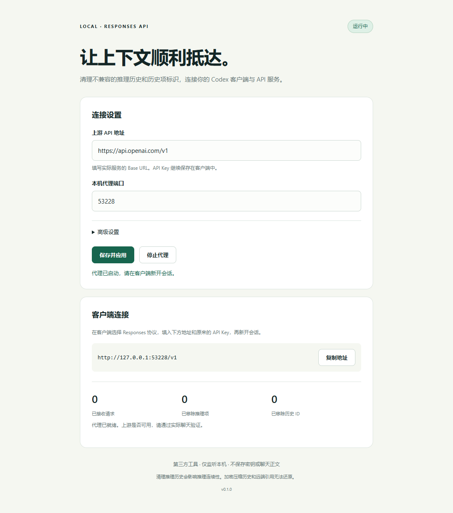

# Codex Context Bridge

[](https://github.com/EdwardWGQ/codex-context-bridge/actions/workflows/checks.yml)
[](LICENSE)

给 Codex / Responses API 客户端使用的本机上下文兼容代理。移除请求中的推理历史和历史项 ID，再将请求转发给你选择的上游服务，缓解部分中转服务的历史兼容问题。

这是第三方工具，未获得 OpenAI 官方背书。项目受到 [codex-context-cleaner](https://github.com/huxi7/codex-context-cleaner) 的功能启发，采用独立实现；不包含原项目的源码或界面资源。



## 工作方式

```text
Codex / Responses 客户端
        ↓ http://127.0.0.1:8787/v1
Context Bridge：清理 outgoing input
        ↓ 你的上游 Base URL + /responses
上游 API 服务 → JSON / SSE 原样返回客户端
```

- 丢弃 `input` 数组中 `type: reasoning` 的历史项，包括其中的不透明推理内容。
- 仅删除剩余历史项的顶层 `id`，保留 `call_id`、`file_id`、消息内容、工具定义和其他配置。
- 支持 `/responses`、`/v1/responses` 及对应 `/compact` 路径；SSE 流逐块转发。
- 提供中文网页设置、代理启停、请求数及清洗计数。
- 默认拒绝依赖远端 `conversation`、`previous_response_id`、`item_reference` 或加密 `compaction` 的请求。
- 保持 TLS 证书验证，使用系统/环境代理；不跟随上游重定向，不自动重试 POST 请求。

这不会删除本地聊天记录，也不会解密或恢复只存在上游的历史。它不是通用上下文压缩器，不保证降低费用或提高模型能力。

## 快速开始

### Windows 10 / 11

1. 从 [Releases](https://github.com/EdwardWGQ/codex-context-bridge/releases) 下载并完整解压源码包，或克隆本仓库。
2. 双击 `start.cmd`。优先使用已有 Python 3.10+；没有时，从 python.org 下载并校验独立 Python（x64 / x86 / ARM64），安装到项目 `.runtime`，无需管理员权限。
3. 浏览器打开本机设置页，填写上游地址，例如 `https://api.openai.com/v1` 或你实际使用的中转服务 Base URL。
4. 保存设置并点击“启动代理”。
5. 在客户端中选择 **Responses** 协议，设置地址为 `http://127.0.0.1:8787/v1`，API Key 仍填写原上游 Key。
6. **新开会话**，通过实际聊天验证连接。

启动入口打开的是设置页；代理需要在设置页启动。代理默认端口 8787，设置服务使用独立的随机本机端口。重复双击启动入口会回到已有设置服务。

关闭浏览器不会停止后台服务。页面“停止代理”保留设置服务；双击 `stop.cmd` 会关闭代理和设置服务。仍有请求进行时，普通停止或配置变更会被拒绝，以免中断回复。

### macOS / Linux / 已有 Python 的 Windows

需要自己安装 Python 3.10+，没有第三方 Python 依赖。在仓库目录执行：

```bash
python3 -m bridge
```

Windows 命令行可使用 `python -m bridge`。macOS / Linux 提供命令行运行方式，没有 `.app` 安装包，也不会自动安装 Python。

保存设置后，可以无浏览器启动并直接开启代理：

```bash
python3 -m bridge --no-browser --start-proxy
python3 -m bridge --open-running
python3 -m bridge --status
python3 -m bridge --stop
```

前台运行时 `Ctrl+C` 退出服务。不要在运行期间移动文件夹。

## 配置

初次启动无需创建 `config.json`；保存设置后会自动生成。也可复制 `config.example.json` 为 `config.json` 并编辑。

```json
{
  "upstream_url": "https://api.openai.com/v1",
  "port": 8787,
  "timeout_seconds": 600,
  "allow_response_link_removal": false
}
```

`upstream_url` 是 API Base URL，应保留服务要求的 `/v1` 或其他前缀，不填写 `/responses`。超时是每次网络等待的上限，而非整次回复的总时间。

**只有确认客户端每次都发送完整聊天历史时，才可开启 `allow_response_link_removal`。** 此时会移除 `previous_response_id`，全部上下文依靠客户端提供的 `input`。只发送新消息的客户端必须保持关闭，否则会丢失历史。

上游切换或旧会话报错时，优先新开会话。配置在运行中保存会重启代理；失败时尝试恢复原配置和服务。清洗计数按每次代理启动重新统计。

## 限制与隐私

- 推理历史与可见消息历史不同。清理推理项会影响推理连续性，不能保证所有模型和中转服务兼容。
- 加密压缩项和远端历史引用不能恢复。即使提供 `/responses/compact` 转发，也无法在之后重放加密压缩项。
- 只支持 HTTP POST Responses / SSE，不支持 WebSocket、Chat Completions、文件上传或模型列表接口。客户端若强制依赖这些接口，不能直接使用。
- 请求体上限 32 MiB，要求未压缩 JSON 和唯一的 Content-Length。
- API Key 不写入配置；认证头和其他端到端请求头会转发给你设置的上游。消息内容会经过本机代理并发送到该服务，请使用你信任的服务。
- 不记录聊天正文和请求头。Windows 日志在 `.runtime`；其中的服务状态含本机控制令牌，应保留在本机。
- 仅监听 `127.0.0.1`，不适合公网部署。本机其他进程属于信任边界；设置接口使用随机令牌、Host 和 Origin 检查。
- 未设置开机自启，不自动修改 Codex 配置。运行时需要保持网络连接。

协议语义参考 OpenAI 官方文档：[会话状态](https://developers.openai.com/api/docs/guides/conversation-state)、[推理历史](https://developers.openai.com/api/docs/guides/reasoning)。上面的清洗策略属于本项目的兼容性选择，并非官方推荐的通用优化方案。

## 开发与发布

```bash
python -m unittest discover -s tests -v
python tools/package.py
```

测试使用本机模拟上游，无需 API Key，也不会调用付费模型。覆盖清洗规则、工具引用、JSON/SSE 转发、HTTP 错误、设置认证和生命周期。GitHub Actions 配置了 Windows、macOS、Linux 及 Python 3.10/3.13 的测试矩阵。

打包仅收录明确列出的程序与说明文件，排除 `config.json`、日志、本机运行环境和令牌。`v*` 标签会触发 GitHub Release，发布源码压缩包。Windows 首次使用仍可能需要联网下载 Python。

开源许可：[MIT](LICENSE)。
